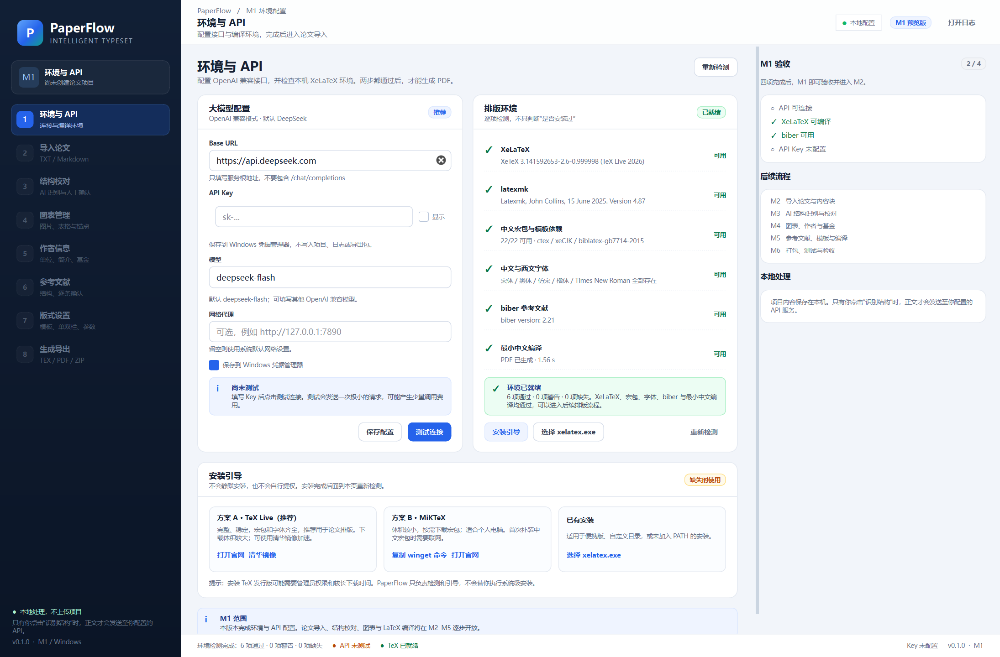

# PaperFlow M1 交付说明

- 版本：0.1.0
- 日期：2026-10-25
- 范围：环境与 API
- 状态：**可运行，M1 通过**



## 1. 已实现

### 1.1 桌面应用骨架

- PySide6 / Qt 6 主窗口
- 左侧 8 步流程导航（M2–M6 步骤灰显，不能误点）
- 顶部项目栏、右侧 M1 验收清单、底部状态栏
- 高 DPI、QSS 主题、中文界面
- Windows 原生日志目录：`%APPDATA%\PaperFlow\logs\paperflow.log`

### 1.2 API 配置

- Base URL 默认 `https://api.deepseek.com`
- 模型默认 `deepseek-flash`，可编辑并选择 `deepseek-v4-pro`
- API Key 密码输入、显示/隐藏
- 网络代理可选
- “保存配置”和“测试连接”
- 测试连接使用一次 `max_tokens=8` 的极小 Chat 请求
- DeepSeek 端点自动关闭 thinking（`extra_body={"thinking": {"type":"disabled"}}`）
- 错误中文化：401 / 402 / 403 / 404 / 422 / 429 / 5xx / 超时 / 网络错误

### 1.3 密钥安全

- 使用 Windows Credential Manager（`keyring`）
- Key 不写入 `settings.json`、日志或项目
- 凭据后端不可用时退化为内存保存，并在界面明确提示
- 关闭“保存到 Windows 凭据管理器”后，Key 仅本次会话有效
- 日志带脱敏过滤器，`sk-...`、Bearer token、`api_key=` 会被替换

### 1.4 XeLaTeX 环境检测

逐项真实检测：

- `xelatex --version`
- `latexmk --version`
- `kpsewhich` 检查 22 个宏包：ctex、xeCJK、fontspec、geometry、fancyhdr、booktabs、tabularx、longtable、caption、float、enumitem、hyperref、xcolor、amsmath、amssymb、graphicx、array、multirow、algorithm、algorithmic、biblatex、biblatex-gb7714-2015
- Windows 字体：宋体、黑体、仿宋、楷体、Times New Roman
- `biber --version`
- 实际编译一份最小中文文档（ctex + 中文 + 表格），检查 PDF 字节数 > 0

检测在后台 `QThread` 中执行，不阻塞 UI；包检查并行化，当前机器约 3.3 秒。

### 1.5 安装引导

- TeX Live（推荐）：打开官方 Windows 页面，或打开清华镜像下载页
- MiKTeX：复制 `winget install --id MiKTeX.MiKTeX -e`，打开官网
- 已有安装：选择 `xelatex.exe`
- 明确说明：不静默安装、不自行提权
- 安装后“重新检测”

## 2. 验证结果

| 项目 | 结果 |
|---|---|
| Python 3.12.10 | 通过 |
| PySide6-Essentials 6.8.3 | 通过 |
| 依赖导入 | 通过 |
| `ruff check src tests` | 通过 |
| `pytest` | **29 passed** |
| 本机真实环境检测 | **6 项通过 / 0 警告 / 0 缺失** |
| 最小中文编译 | **PDF 已生成，约 1.05 s** |
| 本地 OpenAI 兼容 mock API | **连接成功，346 ms，usage 正常** |
| `python -m paperflow --smoke-test --no-auto-detect` | **exit 0** |

### 关于真实 DeepSeek API

本次开发没有可用的真实 DeepSeek Key，因此没有向官方端点发起计费请求。连接路径已用**本地 OpenAI 兼容 mock 服务**做端到端验证；用户填入真实 Key 后即可测试官方端点。UI 截图中的“API 未测试”是真实状态，不是伪造。

## 3. 运行

```powershell
cd D:\coding\autoformatting2
.\run.bat
```

也可以直接双击 `run.bat`。`run.bat` 使用 `-ExecutionPolicy Bypass`，避免 Windows 默认策略拦截本地 PowerShell 脚本。

首次运行：

1. 创建 `.venv`（Python 3.12）
2. 安装 `uv`
3. 用 `uv` 安装项目依赖
4. 启动 PaperFlow

之后启动不会重复安装。

调试：

```powershell
.\run.bat --debug
```

## 4. 当前限制

- M2–M6 的导入、结构识别、图表、参考文献、LaTeX 模板、PDF 预览尚未实现；导航中灰显。
- M1 还没有论文项目，因此右侧是“M1 验收”而不是 PDF 预览。
- 没有真实 DeepSeek Key 测试。
- 环境检测中 `biber` 的 PAR 临时目录和 XeLaTeX 的 `TMP/TEMP` 已做隔离，避免污染系统临时目录。
- M1 通过源码运行，尚未生成 Inno Setup / PyInstaller 安装包（M6）。

## 5. 下一步 M2（已完成）

M2 已按 TXT/Markdown 范围完成，见 [M2 交付说明](M2-交付说明.md)。当时的目标：

1. TXT 编码识别与段落化；
2. Markdown 解析标题、段落、表格、图片路径和公式；
3. 生成带稳定 ID 的 `DocumentIR`；
4. 导入页与解析预览；
5. 不丢段、不静默丢表格/图片；
6. 为 M3 的结构识别准备规范化文本。

## 6. 关键文件

- `src/paperflow/app.py`：应用入口、日志、主题
- `src/paperflow/ui/main_window.py`：主窗口、导航、右侧验收卡片
- `src/paperflow/ui/setup_page.py`：M1 环境与 API 页面
- `src/paperflow/core/config.py`：非敏感设置
- `src/paperflow/core/secrets.py`：Windows 凭据
- `src/paperflow/core/api.py`：DeepSeek / OpenAI 兼容客户端
- `src/paperflow/core/env.py`：XeLaTeX / 宏包 / 字体 / biber / 编译探测
- `tests/`：29 个单元与 UI 测试