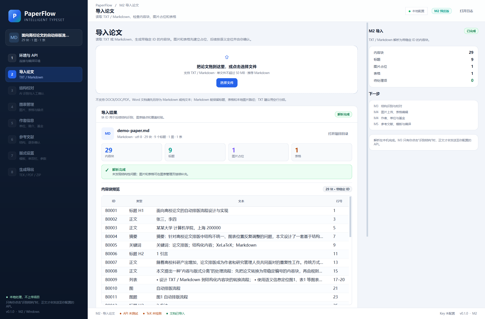
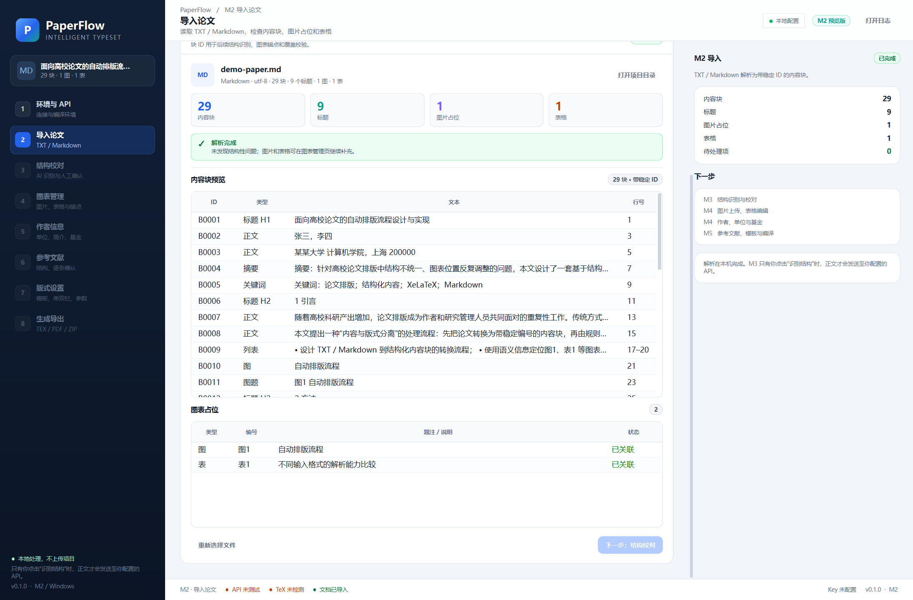

# M2 交付说明：TXT / Markdown 导入

- 版本：0.1.0
- 日期：2026-10-25
- 范围：TXT / Markdown 导入、`DocumentIR`、导入页与块预览
- 设计依据：[设计方案 V1.4](设计方案与工作计划.md)

## 1. 本阶段完成内容

### 1.1 TXT 导入

- `charset-normalizer` 编码识别，支持 UTF-8（含 BOM）、GB18030、GBK；
- 按空行分段，保留每块起止行号；
- 标题规则：`1 引言`、`2.1 方法`、`第 1 章`、`参考文献`、`致谢` 等；
- 识别 `摘要`、`关键词`、`图1`、`表1`；
- Tab 分隔表格识别为结构化表格；
- 图片没有嵌入载体，统一进入“待上传”状态；
- 表格题注没有可识别数据时，进入“待补充”状态。

### 1.2 Markdown 导入

使用 `markdown-it-py` + `mdit-py-plugins`，支持：

- `#`–`####` 标题；
- 段落、粗体、斜体、行内代码；
- 有序/无序列表；
- 引用块；
- 代码围栏；
- GFM 管道表格；
- 本地图片 ``；
- `$...$` 行内公式与 `$$...$$` 独立公式；
- 原始 HTML：保留为待处理块并警告，不渲染；
- 远程图片 URL：不下载，标记为“远程未下载”。

### 1.3 DocumentIR

每个内容块包含：

```json
{
  "id": "B0007",
  "kind": "paragraph",
  "text": "本文研究流程如图1所示。",
  "heading_level": null,
  "runs": [{"text": "本文研究流程如图1所示。", "bold": false, "italic": false}],
  "source": {
    "file": "demo-paper.md",
    "line_start": 15,
    "line_end": 15,
    "format": "markdown",
    "block_index": 7
  },
  "asset_id": null
}
```

图表对象单独存放在 `figures` / `tables` 中，并通过 `asset_id` 与内容块关联。

### 1.4 项目工作区

导入时自动创建：

```text
%APPDATA%\PaperFlow\projects\<时间>-<文件名>-<短ID>/
├─ project.json
├─ source/original.md
├─ assets/figures/
├─ assets/tables/
├─ content/manuscript.json
├─ content/import-result.json
├─ output/
└─ build/
```

原始文件会复制到项目内；Markdown 本地图片会复制到 `assets/figures/`。

### 1.5 导入页

- 拖拽或选择文件；
- 后台线程解析，不阻塞 UI；
- 文件信息、格式、编码、块数、标题数、图表数；
- 解析警告与待处理项；
- 内容块表格：ID、类型、文本、行号；
- 图表占位表：编号、题注、状态；
- 打开项目目录；
- 左侧导航开放“导入论文”，右侧显示 M2 摘要；
- 状态栏显示“文档已导入”。

## 2. 实际界面



示例使用 `examples/demo-paper.md`：29 个内容块、9 个标题、1 个图片占位、1 个表格、0 个警告。

滚动到下方可查看图表占位与下一步按钮：



## 3. 验证结果

| 项目 | 结果 |
|---|---|
| `ruff check src tests` | 通过 |
| `pytest` | **36 passed** |
| Markdown 示例 | 29 块 / 9 标题 / 1 图 / 1 表 / 0 警告 |
| TXT 示例 | 20 块 / 6 标题 / 1 图（待上传）/ 1 表 / 1 警告 |
| GB18030 TXT | 编码识别、标题、图题、TSV 表格均通过 |
| 远程/缺失/越界图片 | 均进入待处理状态，不静默读取 |
| 无题注 Markdown 表格 | 自动编号并产生警告 |
| 空文件 / DOCX | 明确拒绝，不进入解析 |
| 项目 JSON | `manuscript.json`、`import-result.json` 写入成功 |
| UI 冒烟 | 主窗口、导航、导入页、后台导入通过 |

## 4. 如何试用

```powershell
cd D:\coding\autoformatting2
.\run.bat
```

1. 点击左侧“导入论文”；
2. 选择 `examples/demo-paper.md`；
3. 查看 KPI、内容块表和图表占位；
4. 点击“打开项目目录”查看生成的 `manuscript.json`；
5. 再试 `examples/demo-paper.txt`，观察图片待上传警告。

## 5. 已知限制

- 不支持 DOCX/DOC/PDF；Word 文档需先另存为 TXT 或 Markdown。
- TXT 以空行分段；没有空行的长文本会作为一个内容块，建议整理后再导入。
- Markdown 表格不支持合并单元格、嵌套表格。
- 远程图片不自动下载；图片路径必须在源 Markdown 所在目录内。
- 原始 HTML 不渲染，保留为 `unknown` 块并警告。
- 复杂公式只保留文本，后续由用户确认/补充。
- M2 不调用 AI，不做结构校对、图片上传、表格编辑。
- 项目文件已落盘，但导入页还没有“最近项目/重新打开”入口（M6）。
- 图表锚点目前只记录“前一个块”，语义定位在 M3 完成。

## 6. 下一步 M3（已完成）

M3 已完成，见 [M3 交付说明](M3-交付说明.md)。当时计划：

1. DeepSeek/OpenAI 兼容结构识别；
2. JSON Schema + Pydantic 校验；
3. 块覆盖检查，禁止丢块/重复；
4. 章节树与人工校对页；
5. 图表引用与题注的语义定位；
6. 失败重试与本地规则回退。