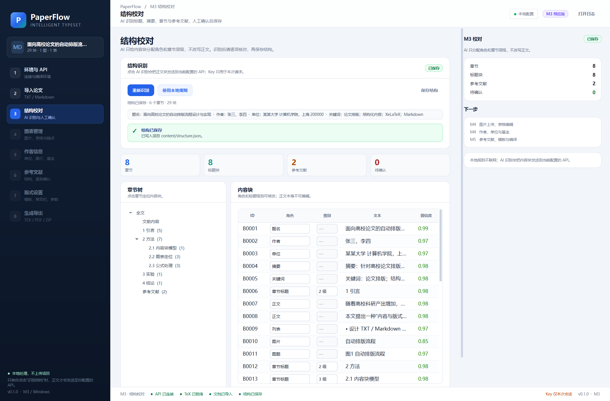

# M3 交付说明：AI 结构识别与校对

- 版本：0.1.0
- 日期：2026-10-26
- 范围：DeepSeek/OpenAI 兼容结构识别、JSON 校验、覆盖检查、结构校对页、结构保存
- 设计依据：[设计方案 V1.4](设计方案与工作计划.md)

## 1. 本阶段完成内容

### 1.1 结构识别客户端

- 复用 M1 的 OpenAI 兼容客户端配置（Base URL、模型、代理、超时）
- 默认 `deepseek-flash`，DeepSeek 请求自动关闭 thinking
- `response_format={"type":"json_object"}`，temperature 0.1
- 只发送内容块文本，不发送 API Key、文件路径或图片二进制
- 鉴权失败、余额不足、限流、超时、网络错误、模型参数错误均有中文提示
- 空内容、截断、JSON 解析失败、覆盖校验失败时自动重试一次
- 日志只记录 base_url、模型、块数、字符数、token 和耗时，不记录正文和 Key

### 1.2 结构 Schema

```json
{
  "metadata": {
    "title": "论文题名",
    "authors": ["作者1"],
    "affiliations": ["单位1"],
    "abstract": "摘要正文",
    "keywords": ["关键词1"],
    "language": "zh"
  },
  "blocks": [
    {
      "block_id": "B0001",
      "role": "title",
      "heading_level": null,
      "confidence": 0.99,
      "note": ""
    }
  ]
}
```

角色固定为：题名、副题、作者、单位、摘要、关键词、章节标题、正文、列表、代码、图片、图题、表格、表题、公式、参考文献、致谢、附录、未确定。

### 1.3 覆盖校验

生成前检查：

- 每个输入 `block_id` 必须出现且只出现一次；
- 不允许新增不存在的块；
- 缺块、重复块、额外块会显示具体 ID，并触发一次重试；
- 重试仍失败则中止，不把残缺结果写入项目。

### 1.4 本地规则回退

不联网也能运行：

- 使用 M2 已有的块类型作为角色基线；
- 从题名、作者、单位、摘要、关键词块提取元数据；
- 识别标题层级并构建章节树；
- 标记“未确定”块和缺失标题级别；
- 适合没有 Key、API 故障或不想发送正文时使用。

### 1.5 结构校对页

- 章节树：点击章节定位内容块；
- 内容块表：ID、角色、级别、文本、置信度；
- 角色可下拉修改；
- 标题级别可下拉修改，非标题自动禁用；
- AI 识别与本地规则两个入口；
- 进度条、错误提示、token 用量；
- 保存结构：写入 `content/structure.json` 和 `content/manuscript-structured.json`；
- 左侧步骤 3 在导入完成后自动开放；
- 右侧 M3 面板显示章节、标题块、参考文献、待确认数量。

## 2. 实际界面



截图使用 `examples/demo-paper.md` 和真实 DeepSeek 测试 Key，识别后保存：

- 29 个内容块
- 6 个章节（8 个标题块）
- 2 条参考文献
- 0 个待确认项
- 输入 2248 / 输出 906 tokens

## 3. 验证结果

| 项目 | 结果 |
|---|---|
| `ruff check src tests` | 通过 |
| `pytest` | **47 passed** |
| 真实 DeepSeek 连接 | 成功，约 0.5–1.0 s |
| 真实结构识别 | 29 块，6 章节，0 待确认 |
| JSON 格式 | 通过 |
| 覆盖校验 | 缺块/重复块测试通过 |
| 本地规则 | 作者、单位、摘要、关键词、章节树提取通过 |
| 本地 OpenAI 兼容 mock | 结构客户端端到端通过 |
| 结构保存 | `structure.json` / `manuscript-structured.json` 写入成功 |
| UI 冒烟 | 主窗口、导入、结构页、保存通过 |

### Key 安全说明

- 测试 Key 只从本地被忽略的文件读入当前进程环境变量；
- 未写入源码、`settings.json`、项目 JSON、日志、截图或安装包；
- 程序内 Key 仍只通过 Windows 凭据管理器或会话内存保存；
- 截图中的 Key 状态为“仅本次会话”的测试占位，不是真实 Key。

## 4. 如何试用

1. 启动 `.\run.bat`；
2. 在“环境与 API”填写并测试你的 Key；
3. 导入 `examples/demo-paper.md`；
4. 点击左侧“结构校对”；
5. 点击“AI 识别结构”，或“使用本地规则”；
6. 修改角色/级别；
7. 点击“保存结构”，查看项目 `content/structure.json`。

## 5. 已知限制

- 首版一次请求处理全文，超过约 12 万字符会提示拆分，尚未做分块识别。
- 模型可能把“图1”正文引用误判为图题，需要人工校对。
- AI 只给类型和层级，不生成作者/单位/摘要内容，也不改写正文。
- 结构保存只写项目 JSON，M4 才把结构用于图表、作者和基金页面。
- 结构校对页暂无“撤销/重做”和批量修改。
- 参考文献目前只标记为 `reference`，逐条结构化在 M5 完成。
- 图片上传、表格编辑、作者信息表单属于 M4。

## 6. 下一步 M4（已完成）

M4 已完成，见 [M4 交付说明](M4-交付说明.md)。当时计划：

1. 图片上传、替换、预览、宽度和跨栏设置；
2. 表格编辑器、CSV/Excel 粘贴、三线表；
3. 图表锚点确认；
4. 多作者、多单位、通信作者、作者简介；
5. 基金开关与多项目；
6. 正文候选自动预填、字段来源标记、正文/表单冲突确认；
7. `consumed_block_ids`：已吸收的正文块不重复输出；
8. 元数据保存与结构联动。