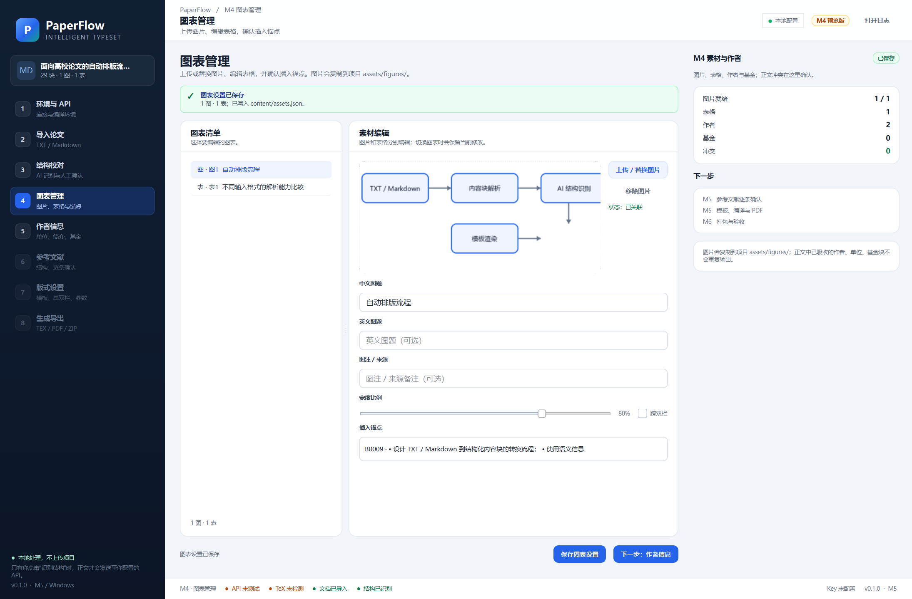
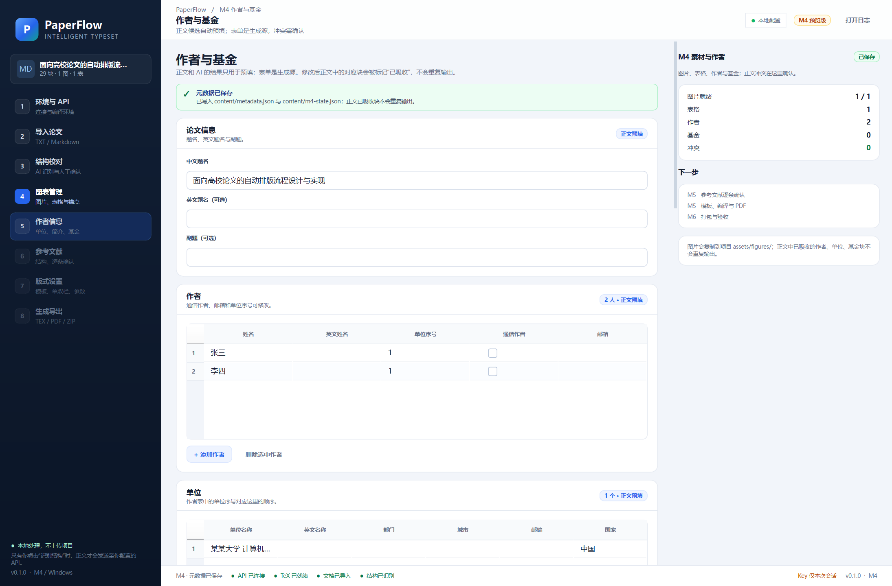
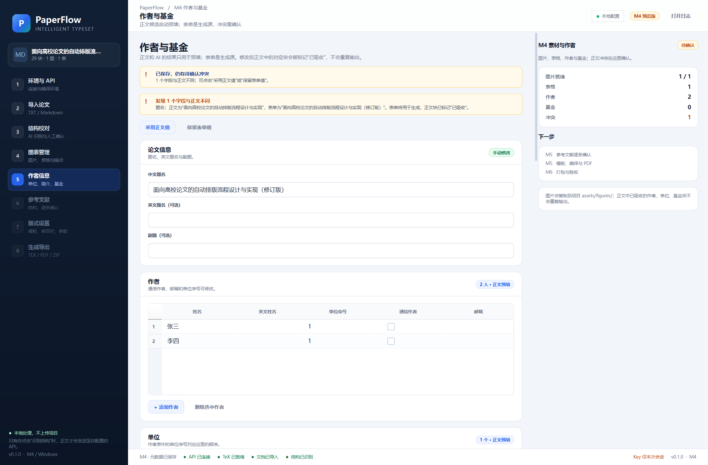
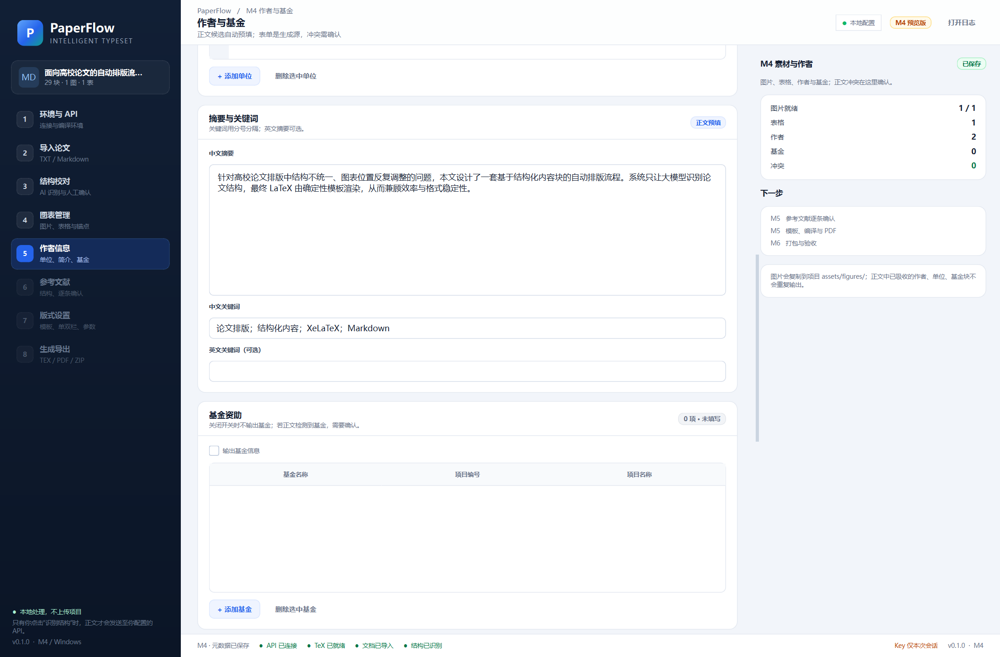

# M4 交付说明：图表管理、作者与基金

- 版本：0.1.0
- 日期：2026-10-26
- 范围：图片上传/替换、表格编辑、锚点、作者/单位/基金/作者简介、正文与表单冲突
- 设计依据：[设计方案 V1.4](设计方案与工作计划.md)

## 1. 图表管理

### 1.1 图片

- Markdown 已关联图片直接预览；
- TXT 缺失图片进入“待上传”；
- 上传/替换 PNG、JPG、JPEG；
- 图片复制到 `assets/figures/<figure_id>.<ext>`；
- 可修改中文图题、英文图题、图注/来源；
- 宽度比例 25%–100%；
- 跨双栏；
- 插入锚点选择；
- 移除图片后状态回到“待上传”。

### 1.2 表格

- 编辑 M2 解析出的单元格；
- 增加/删除行、列；
- 从剪贴板粘贴 CSV 或 Excel（Tab 分隔）数据；
- 修改中文/英文表题、表注；
- 跨双栏与插入锚点；
- 保存后状态随数据是否为空自动变为 `ready` / `pending`。

### 1.3 保存

写入：

```text
content/assets.json
```

包括 `figures` 与 `tables` 的完整模型。

## 2. 作者与基金

### 2.1 自动预填

进入 M4 时从 M3 结构和正文预填：

- 中文题名、摘要、关键词；
- 作者列表；
- 单位列表；
- 作者简介；
- 正文中的基金信息。

每个区块显示来源：

- `正文预填`
- `AI 预填`
- `手动修改`
- `未填写`

### 2.2 表单字段

- 论文：中文题名、英文题名、副题；
- 作者：姓名、英文姓名、单位序号、通信作者、邮箱；
- 单位：名称、英文名称、部门、城市、邮编、国家；
- 摘要与中英文关键词；
- 基金：开关、名称、编号、项目名称；
- 作者简介；
- 其他：中图分类号、文献标志码、文章编号、DOI、收稿日期、致谢、备注。

### 2.3 正文/表单冲突

实现设计 V1.4 的规则：

- 表单是生成源，正文是候选/证据；
- 字段不同时显示冲突横幅，列出正文值和表单值；
- `采用正文值`：把表单重置为正文候选；
- `保留表单值`：把冲突标记为已确认，后续保存不再反复提示；
- 正文中的题名/作者/单位/摘要/关键词块写入 `consumed_block_ids`，生成时跳过，避免重复输出；
- 基金开关关闭但正文有基金时，保存会二次确认；
- 作者、单位、基金、作者简介按行编辑，不整段覆盖。

### 2.4 保存

写入：

```text
content/metadata.json
content/m4-state.json
```

`m4-state.json` 同时保存元数据、图片、表格和已吸收块。

## 3. 实际界面

图片与表格：



作者信息与来源标签：



正文/表单冲突：



摘要与基金：



## 4. 验证结果

| 项目 | 结果 |
|---|---|
| `ruff check src tests` | 通过 |
| `pytest` | **57 passed** |
| 图片列表与预览 | 通过 |
| 图片上传/替换 | 通过，文件复制到项目 |
| 表格编辑/增删行列 | 通过 |
| CSV/TSV 粘贴 | 通过 |
| 锚点选择 | 通过 |
| 作者/单位预填 | 通过 |
| 元数据保存 | `metadata.json`、`m4-state.json` 写入成功 |
| 冲突检测/采用正文/保留表单 | 通过 |
| 基金关闭冲突 | 检测通过 |
| 结构→M4 导航 | 通过 |
| 保存后右侧摘要 | 通过 |

示例项目结果：

- 1 张图片就绪（Markdown 本地图片）；
- 1 个表格，3 行 × 5 列；
- 2 位作者，1 个单位；
- 0 项基金；
- 题名/作者/单位/摘要/关键词块写入 `consumed_block_ids`。

## 5. 已知限制

- 图片只支持 PNG/JPG/JPEG；不支持 PDF、SVG、EMF/WMF 自动转换，也不做裁剪/DPI 调整。
- 表格不支持合并单元格、嵌套表、单元格富文本；复杂表格建议作为图片处理。
- 冲突检测是字段/列表级；“采用正文”和“保留表单”是整组操作，暂不支持逐作者/逐单位 diff。
- 基金检测基于正文中的“基金/项目/资助”文本，复杂基金格式仍需人工补充。
- 作者简介目前只做单段文本，不拆职称、学位、研究方向。
- M4 只保存数据，不渲染 LaTeX；字体、字号、三线表实际效果在 M5 验证。
- 项目重新打开/最近项目仍属于 M6。

## 6. 下一步 M5（已完成）

M5 已完成，见 [M5 交付说明](M5-交付说明.md)。当时计划：

1. 参考文献逐条结构化与 `refs.bib`；
2. 国标通用模板与单/双栏参数；
3. Jinja2 渲染 `.tex`；
4. XeLaTeX + biber 编译；
5. PDF 预览、错误诊断与导出；
6. 图表/元数据/参考文献的最终一致性校验。