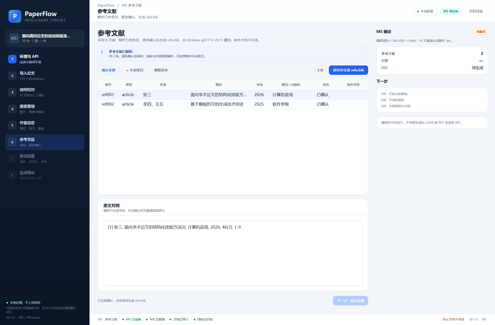
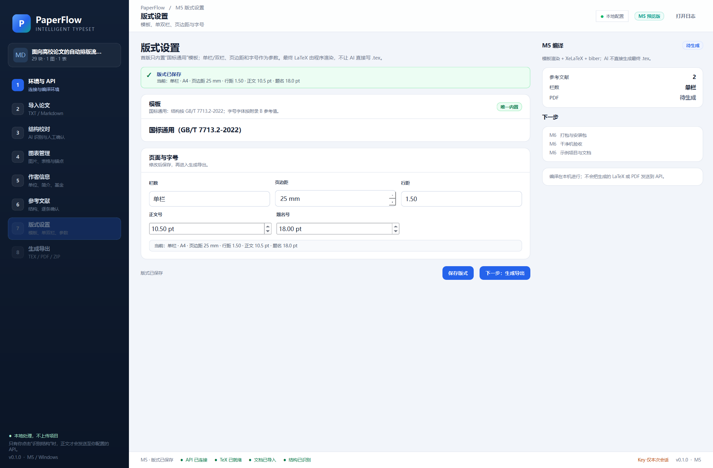
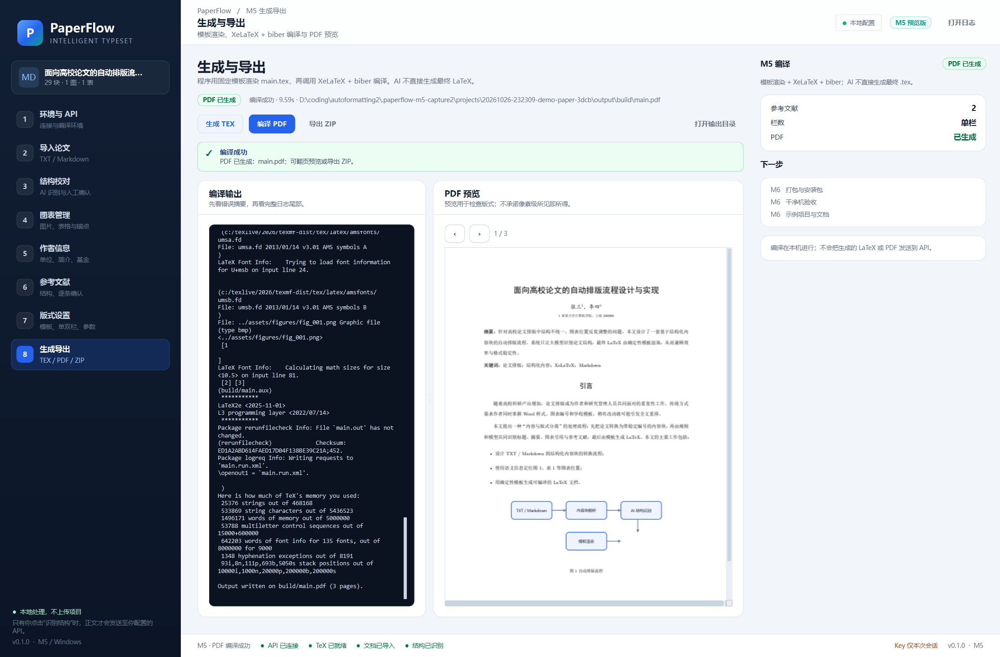
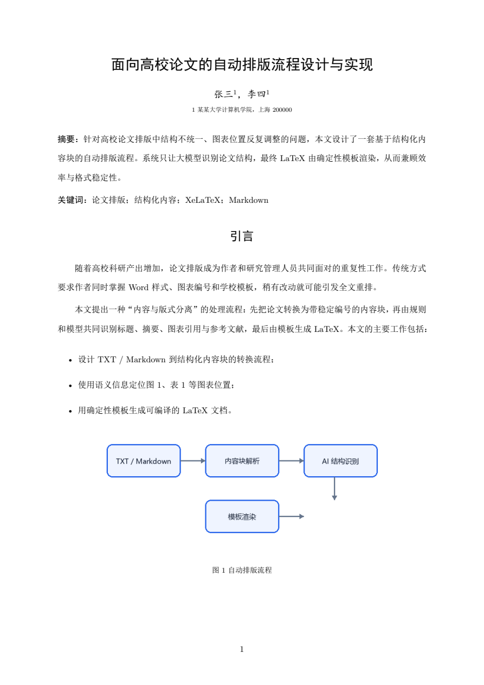
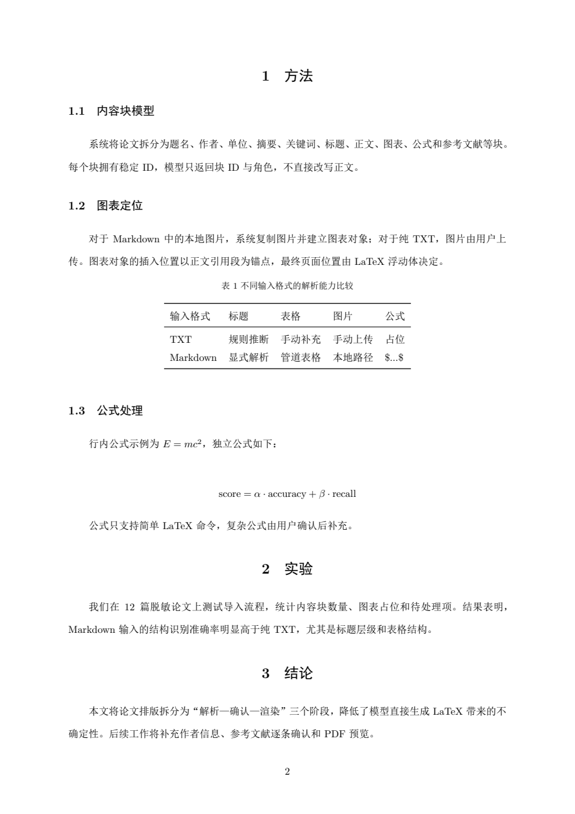
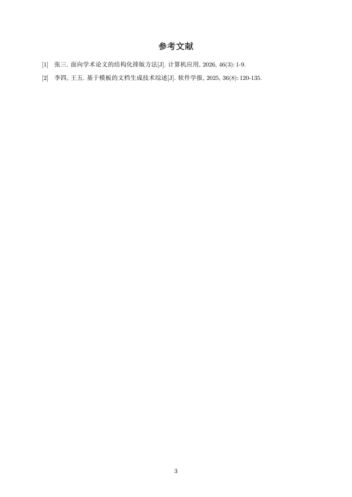

# M5 交付说明：参考文献、模板渲染与 PDF 编译

- 版本：0.1.0
- 日期：2026-10-26
- 范围：参考文献逐条确认、版式参数、确定性 LaTeX 渲染、XeLaTeX + biber 编译、PDF 预览、ZIP 导出
- 设计依据：[设计方案 V1.4](设计方案与工作计划.md)

## 1. 分工：AI 不生成最终 LaTeX

M5 的排版由**固定模板 + 程序 + LaTeX 编译器**完成：

```text
M3 结构
  + M4 图片/表格/作者/基金
  + M5 参考文献确认
  + M5 版式参数
        ↓
Jinja2 模板 + Python 块渲染
        ↓
output/main.tex + output/refs.bib
        ↓
XeLaTeX × 3 + biber
        ↓
output/build/main.pdf
```

AI 只在 M3 做结构识别；M5 的参考文献首版使用**本地规则解析 + 人工修正**，不把正文或最终 `.tex` 交给模型生成。

## 2. 参考文献页

- 自动从 M3 的 `reference` 块提取条目；
- 若 M3 没有 reference 角色，按“参考文献”标题后的段落回退提取；
- 本地规则解析作者、题名、期刊/出版社、年份、卷、期、页码；
- 表格逐条编辑；
- “确认全部”/逐条状态：待确认、已确认、回退原文、不输出；
- 保存：
  - `content/references.json`
  - `output/refs.bib`
- 参考文献由 `biblatex-gb7714-2015` + biber 重排，不在正文中手写格式。



## 3. 版式设置

首版只有“国标通用（GB/T 7713.2-2022）”模板。

可调：

- 单栏 / 双栏；
- 页边距 15–40 mm；
- 行距 1.0–2.0；
- 正文 9–14 pt；
- 题名 12–24 pt。

保存：

```text
content/layout.json
```



## 4. 生成与导出

### 4.1 渲染

`core/render.py` 将以下内容渲染为 `output/main.tex`：

- 题名、作者、单位、通信作者；
- 摘要、关键词；
- 基金、作者简介；
- 章节：引言不编号，后续章节自动编号；
- 段落、列表、代码块、公式；
- 图片：`graphicx`，支持宽度比例、跨栏；
- 表格：`booktabs` 三线表；
- 参考文献：`\nocite{*}` + `\printbibliography`；
- 跳过 `consumed_block_ids` 中的正文块，避免与表单重复。

同时写 `output/refs.bib`。

### 4.2 编译

`core/compile.py` 执行：

1. XeLaTeX 第一遍；
2. biber；
3. XeLaTeX 第二遍；
4. XeLaTeX 第三遍。

输出：

```text
output/build/main.pdf
```

不依赖在线服务，编译在本机完成。

### 4.3 PDF 预览

- 使用 pypdfium2 渲染；
- 支持上一页/下一页；
- 页面按预览区宽度缩放；
- 编译失败时展示 LaTeX 日志尾部。

### 4.4 ZIP 导出

导出：

- `main.tex`
- `main.pdf`
- `refs.bib`
- `metadata.json`、`structure.json`、`references.json`、`layout.json`
- `assets/figures/`、`assets/tables/`

文件位置：`output/paperflow-export.zip`。



## 5. 实际编译结果

使用 `examples/demo-paper.md` + M3 结构 + M4 示例资产：

| 项目 | 结果 |
|---|---|
| 生成 `main.tex` | 成功 |
| 生成 `refs.bib` | 2 条 |
| XeLaTeX + biber | 成功 |
| 页数 | 3 页 |
| 编译耗时 | 约 9.4 s |
| 引言编号 | 不编号 |
| 章节编号 | 1 方法、2 实验、3 结论 |
| 图片 | 正常插入，图 1 |
| 表格 | 三线表，表 1 |
| 参考文献 | 2 条，GB/T 7714 样式 |
| PDF 预览 | 1 / 3 页可翻页 |
| ZIP 导出 | 通过 |

生成的 PDF 页面：







## 6. 测试

| 项目 | 结果 |
|---|---|
| `ruff check src tests` | 通过 |
| `pytest` | **64 passed** |
| 参考文献解析 | 通过 |
| refs.bib 生成 | 通过 |
| 渲染关键结构 | 通过 |
| XeLaTeX + biber 编译 | 通过，PDF ≥ 2 页 |
| 参考文献页保存 | 通过 |
| 版式页保存 | 通过 |
| BuildPage 生成 TEX | 通过 |
| M4 → M5 导航 | 通过 |
| `--smoke-test` | exit 0 |

## 7. 已知限制

- 参考文献首版是**本地规则解析 + 人工修正**，尚未接入 AI 条目解析；复杂英文/会议/标准条目需要手动补字段。
- 正文引用只做简单 `[n]` → `\cite{key}` 映射；复杂引用（作者-年份、多篇合并、页码范围）仍需后补。
- 只内置国标通用模板；不提供学校专用模板、封面、页眉页脚和模板编辑器。
- 字体的最终效果依赖本机 TeX Live 字体；当前使用 ctex 默认字体，未做学校字体替换。
- 表格不支持合并单元格、跨页长表、单元格富文本；复杂表格建议按图片处理。
- 公式只支持简单 LaTeX 命令；复杂公式需人工确认；不支持 OMML。
- PDF 预览只有翻页和按宽度缩放，没有缩放百分比、打印和批注。
- 参考文献状态为“待确认”时仍可编译；正式导出前应逐条确认。
- 项目重新打开、最近项目、安装包与干净机验收属于 M6。

## 8. 可选 M5.5 AI 模块

M5 之后增加了**默认关闭**的可选 AI 模块：

- AI 参考文献解析；
- AI PDF 版式审阅；
- 两套严格 JSON 提示词。

AI 模块只发送参考文献原文或 PDF 页面截图，返回结构化建议；白名单修复只改 `overrides.json` 中的图片宽度/跨栏、表格跨栏、标题前分页，并重新编译，可对比前后 PDF 和回滚，不直接修改正文或最终 `.tex`。没有 Key 时 AI 按钮禁用，M5 编译流程不受影响。

详细说明：[M5.5 AI 模块](M5.5-AI模块.md)。

## 9. 下一步 M6

1. 最近项目 / 重新打开；
2. 打包与安装包；
3. 干净机验收；
4. 示例项目与最终用户文档；
5. 错误提示与回归清单收尾。