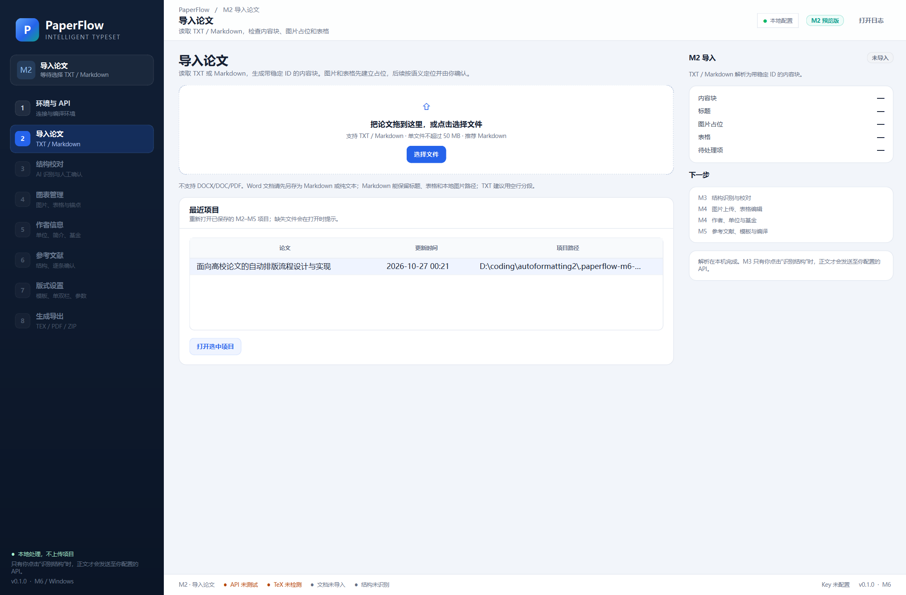

# M6 交付说明：最近项目、打包与干净机验收

- 版本：0.1.0
- 日期：2026-10-27
- 范围：最近项目、项目重新打开、Windows 便携版/安装包脚本、干净机验收清单
- 备份：`backups/paperflow-M5.5-20261027-001432.zip`（不含测试 Key）

## 1. 最近项目

保存位置：

```text
%APPDATA%\PaperFlow\recent-projects.json
```

规则：

- 导入新项目时自动写入；
- 最多保留 10 个；
- 打开失败或目录不存在时自动移除；
- 不保存正文、PDF 或 API Key；
- 导入页显示论文名、更新时间、项目路径；
- 双击或“打开选中项目”重新打开。



## 2. 项目重新打开

`core/project.py` 新增 `load_project()`，恢复：

- `content/import-result.json` 或 `content/manuscript.json`；
- `content/structure.json`；
- `content/m4-state.json`；
- `content/references.json`；
- `content/layout.json`；
- `content/overrides.json`。

打开后：

- 恢复 M2 导入结果；
- 恢复 M3 结构；
- 恢复 M4 图表/作者/基金；
- 恢复 M5 参考文献、版式、白名单 overrides；
- 根据已保存阶段跳转到最远的可用步骤（通常为生成导出）；
- 最近项目列表同步更新。

缺失文件：

- 缺少 `content` 目录：拒绝打开并提示；
- 缺少 M3/M4/M5 文件：能恢复到哪一步就恢复到哪一步；
- 旧项目没有 `overrides.json`：按无覆盖处理。

## 3. Windows 打包

### 3.1 便携版

脚本：

```text
packaging/build-windows.ps1
packaging/paperflow.spec
```

产物：

```text
dist\PaperFlow\PaperFlow.exe
dist\PaperFlow\
```

使用 PyInstaller，包含：

- PySide6；
- pypdfium2；
- keyring Windows 后端；
- 应用资源与图标。

构建：

```powershell
powershell -NoProfile -ExecutionPolicy Bypass -File .\packaging\build-windows.ps1
```

已在开发机实际构建：

```text
dist\PaperFlow\PaperFlow.exe
大小：约 11 MB（exe）
完整目录：约 123 MB
```

打包后的 exe 冒烟测试：

```text
PaperFlow.exe --smoke-test --no-auto-detect
exit 0
```

### 3.2 安装包

Inno Setup 脚本：

```text
packaging/paperflow.iss
```

产物：

```text
dist\installer\PaperFlow-0.1.0-setup.exe
```

安装到当前用户目录，不要求管理员权限；可选桌面快捷方式。

已实际生成：

```text
dist\installer\PaperFlow-0.1.0-setup.exe
大小：约 43.4 MB
SHA256：788A22AF4C20591D4FB72E381D407911596B2A041775B26C5E691E320AF3B5B7
```

校验文件：

```text
dist\installer\PaperFlow-0.1.0-setup.exe.sha256
```

Inno Setup 编译命令：

```powershell
& "C:\Program Files (x86)\Inno Setup 6\ISCC.exe" packaging\paperflow.iss
```

### 3.3 构建说明

详细步骤：[packaging/README.md](../packaging/README.md)

## 4. 干净机验收清单

在**没有 Python、没有源码、没有构建缓存**的 Windows 10/11 x64 上：

1. 安装 TeX Live 或 MiKTeX；
2. 只复制 `dist\PaperFlow`；
3. 双击 `PaperFlow.exe`；
4. 检查 TeX 环境检测；
5. 导入 `examples/demo-paper.md`；
6. 完成结构、图表、作者/基金、参考文献、版式；
7. 生成 PDF 并翻页预览；
8. 导出 ZIP；
9. 关闭 AI 再走一次普通流程；
10. 重新打开最近项目，确认状态恢复；
11. 检查 `%APPDATA%\PaperFlow` 日志不含 Key、正文或 PDF 图片；
12. 记录 Windows 版本、TeX 版本、字体和结果。

## 5. 已知限制

- exe 未做代码签名，SmartScreen 可能提示。
- 没有自动更新、崩溃上报和安装包升级迁移。
- 安装包需要本机安装 TeX Live/MiKTeX；不随安装包捆绑 TeX。
- Inno Setup 本身不随仓库提供，只有 `.iss` 脚本。
- 最近项目记录的是绝对路径；移动项目目录后需要重新导入。
- 旧项目如果缺少 `m4-state.json`，会按结构重建 M4 候选，已上传图片可能丢失。
- 干净机验收需要在真实干净环境执行；开发机测试不能替代。

## 6. 测试

| 项目 | 结果 |
|---|---|
| `ruff check src tests` | 通过 |
| 最近项目保存/读取 | 通过 |
| 最近项目去重/上限 | 通过 |
| 项目状态恢复 | 通过 |
| M4/M5 文件恢复 | 通过 |
| PyInstaller 构建 | 通过，`dist\PaperFlow\PaperFlow.exe` |
| 打包 exe 冒烟 | 通过，exit 0 |
| Inno Setup 安装包 | 通过，`dist\installer\PaperFlow-0.1.0-setup.exe` |
| 安装包大小 / SHA256 | 约 43.4 MB / 已生成 `.sha256` |
| 安装包实际安装 | 待干净机验收 |
| 干净机验收 | 待真实干净环境执行 |
| 完整 `pytest` | **80 passed** |
| AI 编译修复真实诊断 | 通过 |

## 7. 开源发布目录

已生成 MIT 发布目录：

```text
release/PaperFlow-0.1.0/
  LICENSE
  README.md
  RELEASE_NOTES.md
  THIRD_PARTY_NOTICES.md
  pyproject.toml
  requirements-lock.txt
  run.bat / run.ps1
  src/ tests/ examples/ docs/ packaging/
  binaries/
    PaperFlow-0.1.0-win64-portable.zip
    PaperFlow-0.1.0-setup.exe
    PaperFlow-0.1.0-setup.exe.sha256
    SHA256SUMS.txt
```

`release/README.md` 是发布入口说明。

## 8. 最终交付物

```text
src/paperflow/
tests/
examples/
docs/
packaging/
README.md
run.bat / run.ps1
pyproject.toml
```

备份包：

```text
backups/paperflow-M5.5-20261027-001432.zip
```

备份包不包含 `deepseek测试key.txt`、`.venv`、缓存或临时项目。