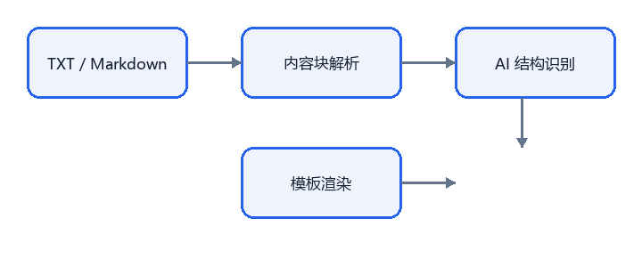

# 面向高校论文的自动排版流程设计与实现

张三，李四

某某大学 计算机学院，上海 200000

摘要：针对高校论文排版中结构不统一、图表位置反复调整的问题，本文设计了一套基于结构化内容块的自动排版流程。系统只让大模型识别论文结构，最终 LaTeX 由确定性模板渲染，从而兼顾效率与格式稳定性。

关键词：论文排版；结构化内容；XeLaTeX；Markdown

## 1 引言

随着高校科研产出增加，论文排版成为作者和研究管理人员共同面对的重复性工作。传统方式要求作者同时掌握 Word 样式、图表编号和学校模板，稍有改动就可能引发全文重排。

本文提出一种“内容与版式分离”的处理流程：先把论文转换为带稳定编号的内容块，再由规则和模型共同识别标题、摘要、图表引用与参考文献，最后由模板生成 LaTeX。本文的主要工作包括：

- 设计 TXT / Markdown 到结构化内容块的转换流程；
- 使用语义信息定位图1、表1 等图表位置；
- 用确定性模板生成可编译的 LaTeX 文档。

图1 自动排版流程

## 2 方法

### 2.1 内容块模型

系统将论文拆分为题名、作者、单位、摘要、关键词、标题、正文、图表、公式和参考文献等块。每个块拥有稳定 ID，模型只返回块 ID 与角色，不直接改写正文。

### 2.2 图表定位

对于 Markdown 中的本地图片，系统复制图片并建立图表对象；对于纯 TXT，图片由用户上传。图表对象的插入位置以正文引用段为锚点，最终页面位置由 LaTeX 浮动体决定。

表1 不同输入格式的解析能力比较

| 输入格式 | 标题 | 表格 | 图片 | 公式 |
|---|---|---|---|---|
| TXT | 规则推断 | 手动补充 | 手动上传 | 占位 |
| Markdown | 显式解析 | 管道表格 | 本地路径 | `$...$` |

### 2.3 公式处理

行内公式示例为 $E = mc^2$，独立公式如下：

$$
\mathrm{score} = \alpha \cdot \mathrm{accuracy} + \beta \cdot \mathrm{recall}
$$

公式只支持简单 LaTeX 命令，复杂公式由用户确认后补充。

## 3 实验

我们在 12 篇脱敏论文上测试导入流程，统计内容块数量、图表占位和待处理项。结果表明，Markdown 输入的结构识别准确率明显高于纯 TXT，尤其是标题层级和表格结构。

## 4 结论

本文将论文排版拆分为“解析—确认—渲染”三个阶段，降低了模型直接生成 LaTeX 带来的不确定性。后续工作将补充作者信息、参考文献逐条确认和 PDF 预览。

## 参考文献

[1] 张三. 面向学术论文的结构化排版方法[J]. 计算机应用, 2026, 46(3): 1-9.

[2] 李四, 王五. 基于模板的文档生成技术综述[J]. 软件学报, 2025, 36(8): 120-135.